

  

<h1 align="center">سندبان · SanadBan</h1>

  اتصال امن دفترخانه به شبکهٔ سازمان ثبت 
  Secure connection from notary offices to the registry network

  
  
  

  <a href="https://mneftekhar.github.io/sanadban-releases/"><b>وب‌سایت · Website</b></a> &nbsp;|&nbsp;
  <a href="https://github.com/mneftekhar/sanadban-releases/releases/latest"><b>دریافت · Download</b></a> &nbsp;|&nbsp;
  <a href="CHANGELOG.md"><b>تغییرات · Changelog</b></a> &nbsp;|&nbsp;
  <a href="#english">English ↓</a>

## سندبان چیست؟

سندبان برنامهٔ ویندوزی است که رایانهٔ دفترخانه را از راه سرورهای VPN سازمان ثبت به شبکهٔ سازمان وصل می‌کند. با یک دکمه وصل می‌شود، فقط ترافیک سازمان را از VPN عبور می‌دهد، اتصال را زنده نگه می‌دارد و اگر ویندوز خطا بدهد، به زبان ساده می‌گوید چه شده و چه باید کرد. جای اتصال‌های جداگانهٔ VPN ویندوز و اسکریپت‌های SsarSplitTunnel را می‌گیرد.

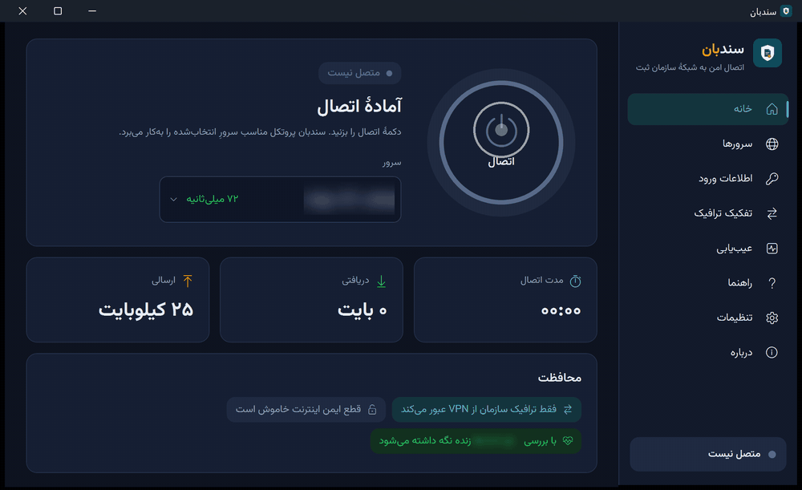

> نام و نشانی سرورها و اطلاعات ورود در همهٔ تصویرهای این صفحه محو شده‌اند.

## امکانات

- **یک دکمه برای اتصال.** برای هر سرور همان پروتکلی به‌کار می‌رود که می‌پذیرد: SSTP، PPTP، L2TP/IPsec یا IKEv2؛ همه از خودِ ویندوز.
- **تفکیک ترافیک.** فقط شبکهٔ سازمان ثبت از VPN عبور می‌کند و نشانی‌های سازمان هنگام اتصال از DNS سازمان پرسیده می‌شوند. باقی اینترنت دفترخانه همان‌طور که بود می‌ماند.
- **اتصالی که برقرار می‌ماند.** بررسیِ زنده بودن اتصال، اتصال دوبارهٔ خودکار با فاصلهٔ رو به افزایش، و «قطع ایمن اینترنت» اختیاری.
- **رمز عبور در امان.** اطلاعات ورود با کلید همین رایانه رمزگذاری می‌شود و فقط سرویس سندبان از آن استفاده می‌کند. یک اطلاعات ورود برای همهٔ سرورها یا یکی برای هر سرور.
- **عیب‌یابی.** آزمایش آداپتورها، DNS، سرورها، اینترنت و VPN، با گزارشی برای پشتیبانی. «راهنما» خطاهای رایج VPN ویندوز (۶۰۲، ۶۹۱، ۸۰۰، ۸۰۹، ۸۶۸) را توضیح می‌دهد.
- **دسترسی مدیر فقط یک بار.** سرویس پس‌زمینه یک بار نصب می‌شود؛ با بستن پنجره اتصال برقرار می‌ماند.
- **به‌روزرسانی خودکار و امضاشده.** نسخهٔ جدید بی‌صدا از همین صفحه دریافت، امضای آن بررسی و هنگام بی‌کاری نصب می‌شود. اگر درست راه نیفتد، نسخهٔ قبلی برمی‌گردد.
- **فارسی و انگلیسی،** راست‌به‌چپِ کامل، پوستهٔ روشن و تیره.

## تصویرها

| خانه | سرورها |
|---|---|
| 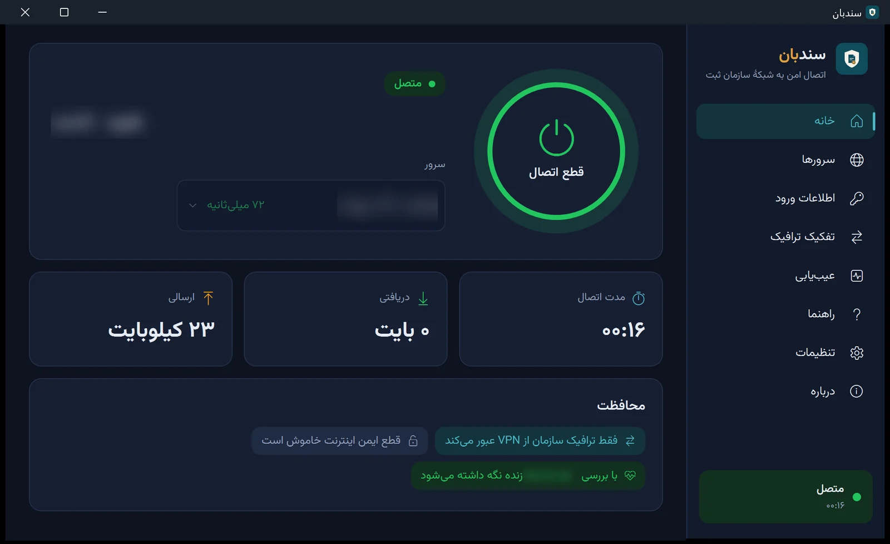 | 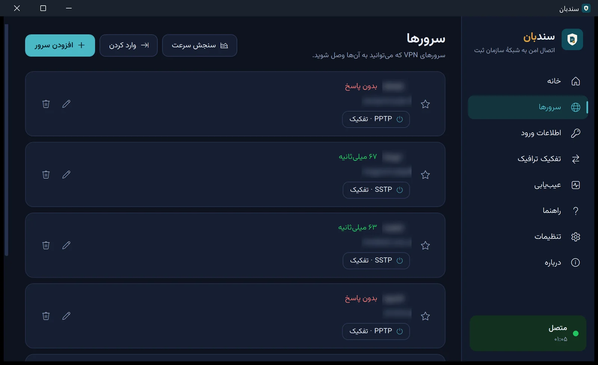 |
| **تفکیک ترافیک** | **اطلاعات ورود** |
| 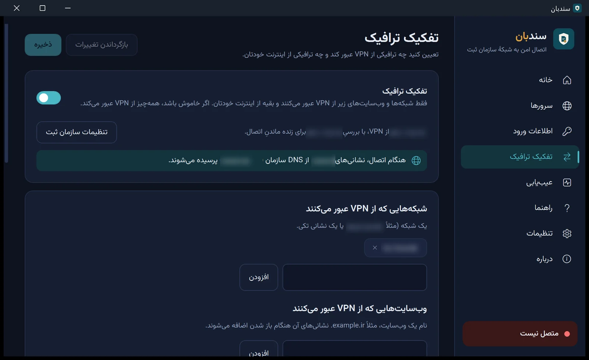 | 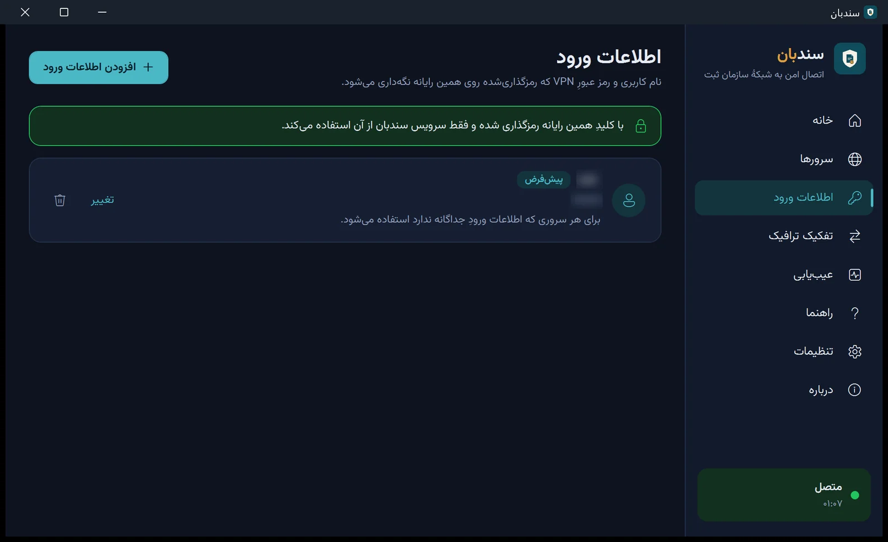 |
| **تنظیمات** | **راهنما** |
| 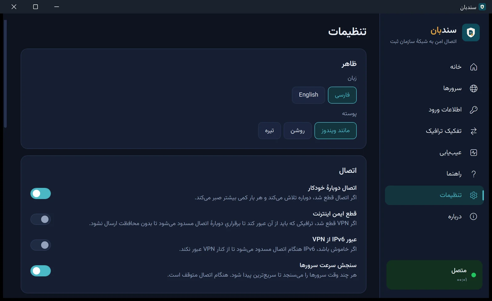 | 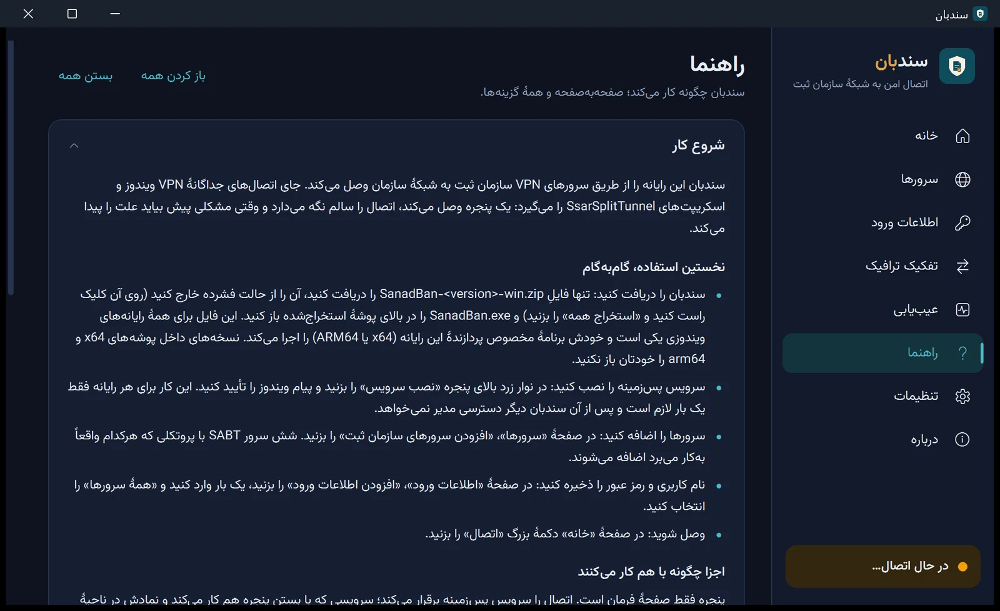 |

گشتی در همهٔ صفحه‌ها (GIF)

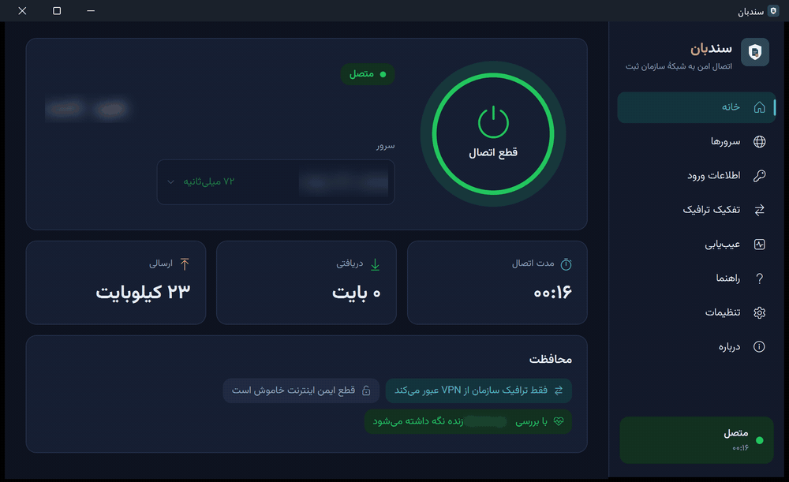

## نصب

۱. از [صفحهٔ آخرین انتشار](https://github.com/mneftekhar/sanadban-releases/releases/latest) فایل <code dir="ltr">SanadBan-&lt;نسخه&gt;-win.zip</code> را دریافت و از حالت فشرده خارج کنید (راست‌کلیک، «استخراج همه»). 
۲. <code>SanadBan.exe</code> را در بالای پوشه باز کنید. خودش برنامهٔ مناسبِ پردازندهٔ رایانه (x64 یا ARM64) را اجرا می‌کند. نسخه‌های داخل پوشه‌های <code>x64</code> و <code>arm64</code> را مستقیم باز نکنید. 
۳. در نوار زرد بالای پنجره «نصب سرویس» را بزنید و پیام ویندوز را تأیید کنید. این کار برای هر رایانه فقط یک بار لازم است. 
۴. در «سرورها» دکمهٔ «افزودن سرورهای سازمان ثبت» را بزنید، در «اطلاعات ورود» نام کاربری و رمز عبور را وارد کنید و در «خانه» «اتصال» را بزنید.

**پیش‌نیاز:** ویندوز ۱۰ یا ۱۱ (x64 یا ARM64) و [‎.NET 10 Desktop Runtime‎](https://dotnet.microsoft.com/download/dotnet/10.0) از مایکروسافت.

## به‌روزرسانی و امنیت

نسخه‌های نصب‌شده خودشان از همین مخزن به‌روز می‌شوند و لازم نیست چیزی را دستی دریافت کنید. هر نسخه فقط وقتی نصب می‌شود که با کلید توسعه‌دهنده امضا شده باشد و همهٔ فایل‌هایش با فهرستِ امضاشده یکی باشد. تغییرات هر نسخه در [CHANGELOG.md](CHANGELOG.md) آمده است.

## حریم خصوصی

اطلاعات ورودِ شما روی همین رایانه رمزگذاری می‌شود و از آن خارج نمی‌شود. گزارش‌ها هم روی همین رایانه می‌مانند. سندبان فقط برای اتصال به سرورهای VPN و بررسی به‌روزرسانی به اینترنت وصل می‌شود.

## سازنده

سندبان را م. افتخار به‌صورت مستقل ساخته است؛ از سرِ احترام به سردفتران ایران، تا هر دفترخانه اتصالی مطمئن به شبکهٔ سازمان ثبت داشته باشد و با خیال آسوده به کار خود برسد. کد منبع خصوصی است؛ این مخزن فقط نسخه‌های امضاشده، تغییرات و وب‌سایت را نگه می‌دارد.

---

## What is SanadBan?

SanadBan is a Windows app that connects a notary office's computer to the registry network through the registry's VPN servers. It connects with one press, sends only registry traffic through the VPN, keeps the connection alive, and when Windows reports an error it says in plain words what happened and what to do. It replaces the separate Windows VPN entries and the SsarSplitTunnel scripts.

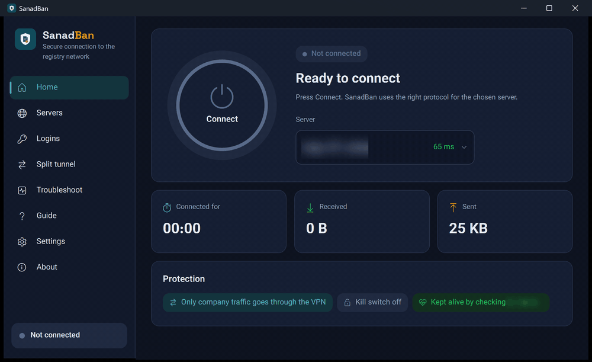

> Server names, addresses and logins are blurred in every picture on this page.

## Features

- **One press to connect.** Each server gets the protocol it accepts: SSTP, PPTP, L2TP/IPsec or IKEv2, all built into Windows.
- **Split tunnel.** Only the registry network goes through the VPN, and registry names are looked up on the registry DNS while connected. The rest of the office internet stays as it was.
- **A connection that stays up.** Keep-alive checks, automatic reconnect that waits a little longer each time, and an optional kill switch.
- **Passwords kept safe.** Logins are encrypted with this computer's key and used only by the SanadBan service. One login for all servers, or one per server.
- **Troubleshoot.** Tests the adapters, DNS, servers, internet and the VPN, and saves a report for support. The Guide explains the common Windows VPN errors (602, 691, 800, 809, 868).
- **Administrator rights once.** The background service is installed once; the connection stays up when the window is closed.
- **Signed automatic updates.** New versions download quietly from this repository, their signature is checked, and they install while the computer is idle. If one does not start properly, the previous version comes back.
- **Persian and English,** fully right-to-left Persian, light and dark themes.

## Screenshots

| Home | Servers |
|---|---|
| 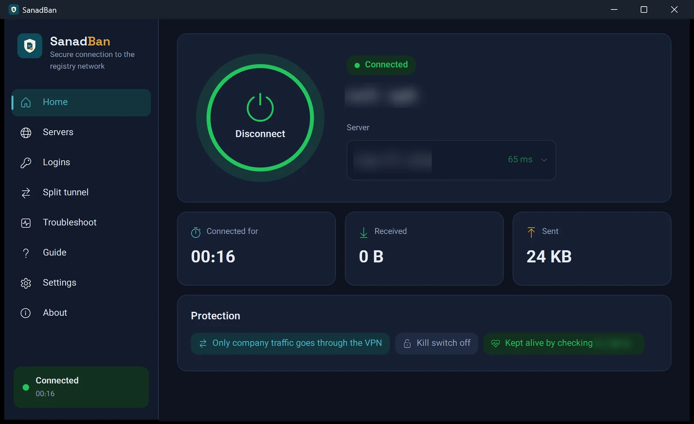 | 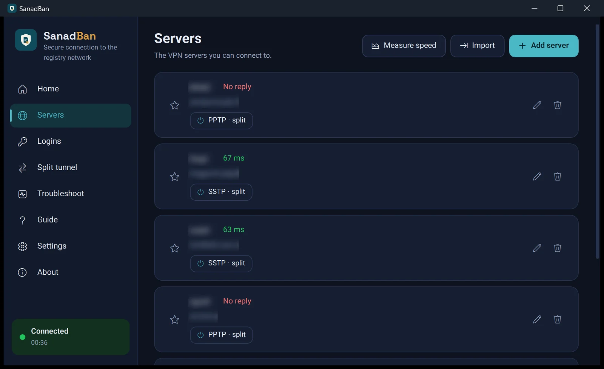 |
| **Split tunnel** | **Logins** |
| 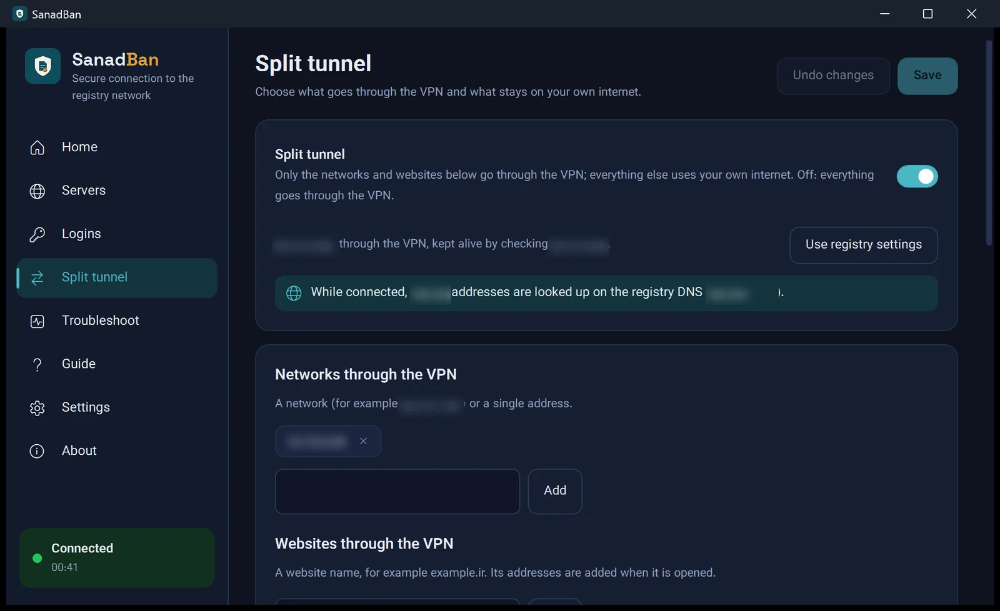 | 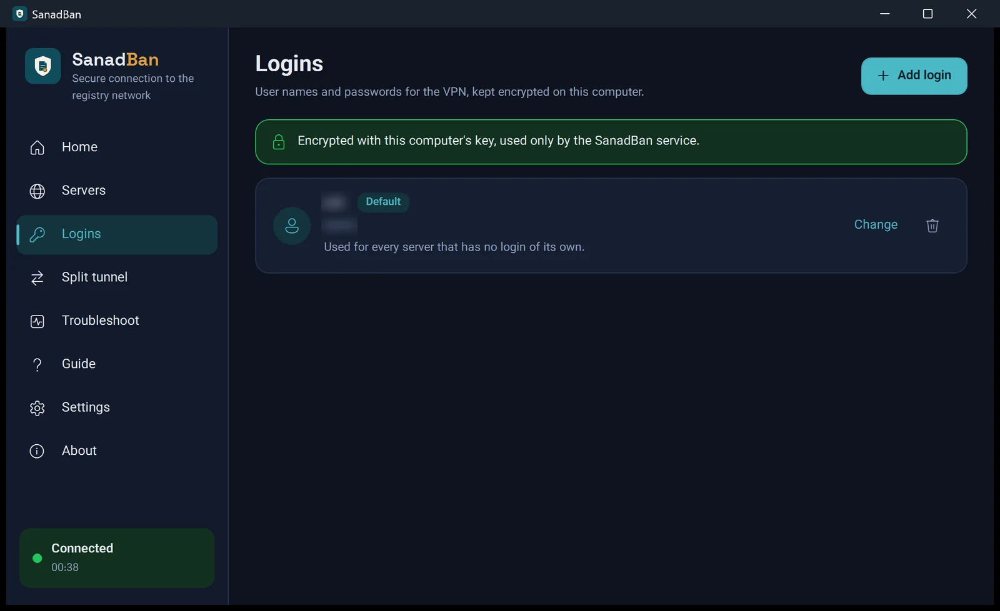 |
| **Settings** | **Guide** |
| 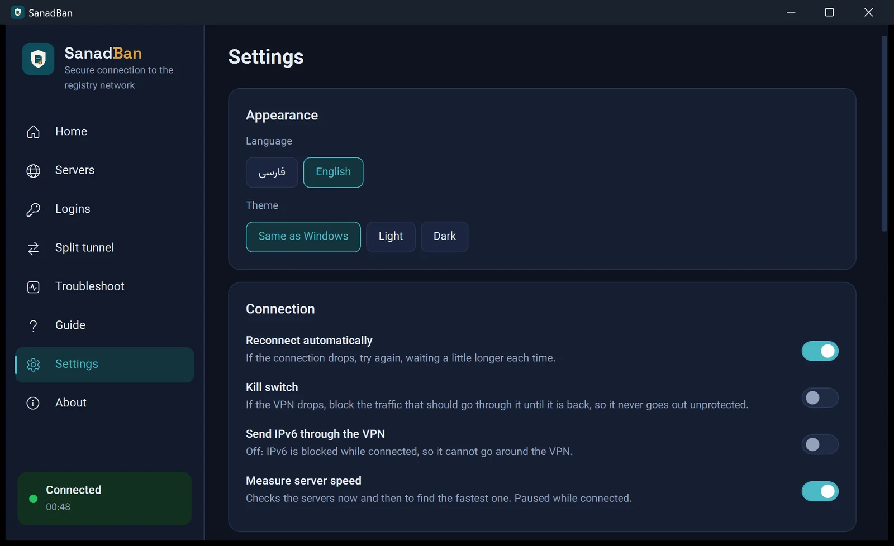 | 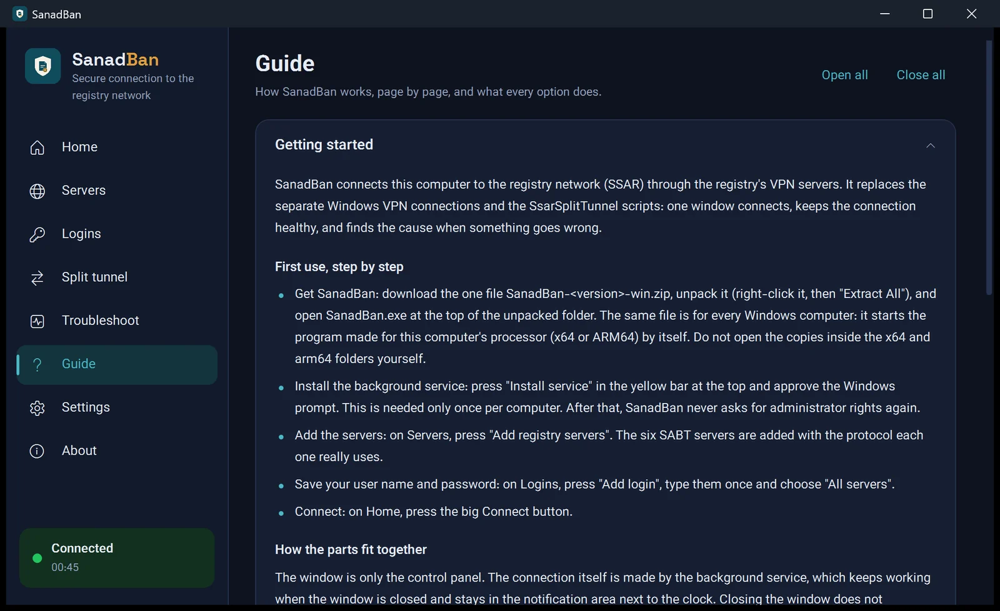 |

A tour of every page (GIF)

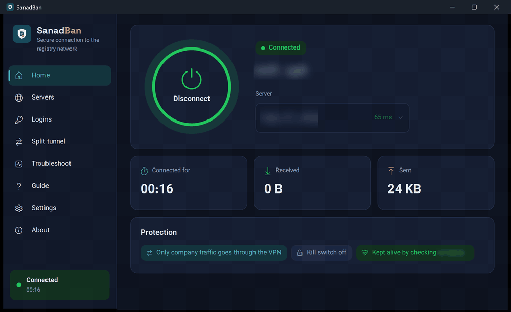

## Install

1. From the [latest release](https://github.com/mneftekhar/sanadban-releases/releases/latest), download `SanadBan-<version>-win.zip` and unpack it (right-click it, then Extract All).
2. Open `SanadBan.exe` at the top of the folder. It starts the right program for the computer's processor (x64 or ARM64). Don't open the copies inside the `x64` and `arm64` folders yourself.
3. Press **Install service** in the yellow bar at the top and approve the Windows prompt. This is needed once per computer.
4. On **Servers** press **Add registry servers**, on **Logins** add your user name and password, then press **Connect** on **Home**.

**Requirements:** Windows 10 or 11 (x64 or ARM64) and Microsoft's [.NET 10 Desktop Runtime](https://dotnet.microsoft.com/download/dotnet/10.0).

## Updates and security

Installed copies update themselves from this repository; nothing here needs to be downloaded by hand after the first install. A version is installed only if it is signed with the developer's key and every file matches the signed list. What changed in each version is in [CHANGELOG.md](CHANGELOG.md).

## Privacy

Your logins are encrypted on this computer and never leave it. Logs and reports are kept on this computer. SanadBan contacts the internet only to reach the VPN servers and to check for updates.

## Author

SanadBan is an independent project by M. Eftekhar (`mneftekhar`). It was made out of respect for Iran's notaries, so that every notary office has a connection to the registry network it can rely on. The source code is private; this repository holds only the signed releases, the changelog and the website.

For administrators: what each release contains

Each release holds:

| File | Purpose |
|---|---|
| `SanadBan-<version>-win.zip` | The one download for a first install, on any Windows PC (x64 or ARM64). |
| `SanadBan-<version>-win-x64.zip`, `SanadBan-<version>-win-arm64.zip` | The update packages; an installed copy takes the one for its own processor. |
| `manifest.json`, `manifest.json.sig` | The signed list of update packages (ECDSA P-256, SHA-256) with each package's SHA-256 and size. |

The website is served from [`docs/`](docs/) with GitHub Pages. The changelog's single source is
[`docs/changelog.json`](docs/changelog.json); `python tools/make_changelog.py` rewrites `CHANGELOG.md` from it.

