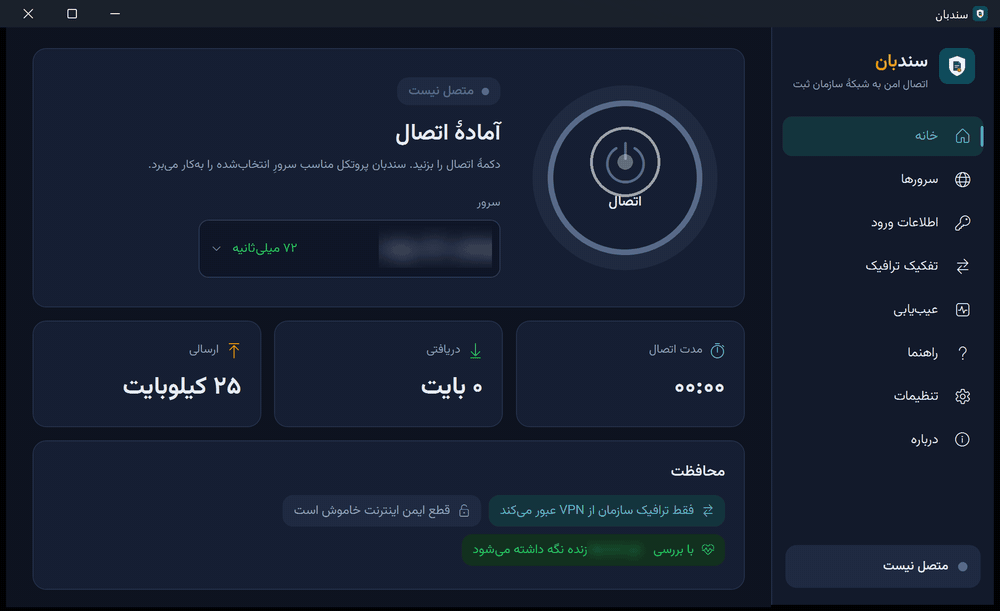
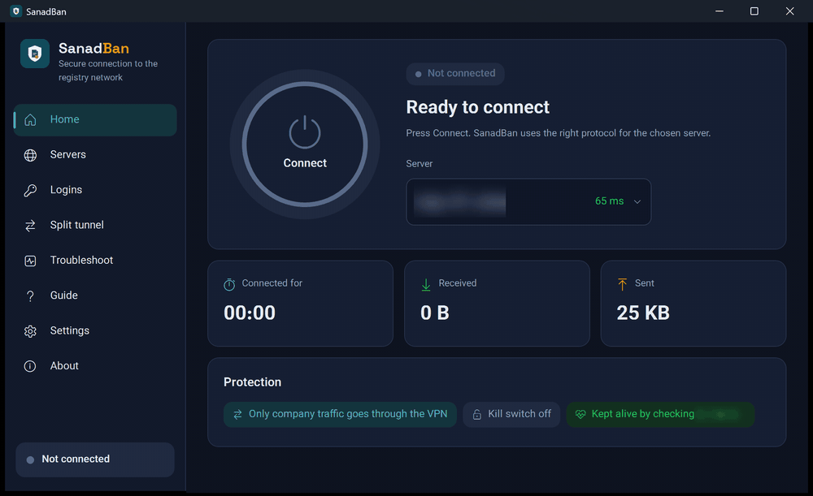

<!-- This page is generated from site/content.json; edit that file, not this one. -->
<p align="center"></p>

<h1 align="center">سندبان · SanadBan</h1>

<p align="center">اتصال امن دفترخانه به شبکهٔ سازمان ثبت<br>Secure connection from notary offices to the registry network</p>

<p align="center">
  <a href="https://github.com/mneftekhar/sanadban-releases/releases/latest"></a>
  
  <a href="https://mneftekhar.github.io/sanadban-releases/"></a>
</p>

<p align="center">
  <a href="README.md">خانه · Home</a> &nbsp;|&nbsp;
  <a href="guides/features.md">امکانات · Features</a> &nbsp;|&nbsp;
  <a href="guides/screenshots.md">تصویرها · Screenshots</a> &nbsp;|&nbsp;
  <a href="guides/install.md">نصب · Install</a> &nbsp;|&nbsp;
  <a href="guides/troubleshooting.md">رفع مشکل · Troubleshooting</a> &nbsp;|&nbsp;
  <a href="guides/faq.md">پرسش‌ها · FAQ</a> &nbsp;|&nbsp;
  <a href="guides/roadmap.md">نقشهٔ راه · Roadmap</a> &nbsp;|&nbsp;
  <a href="guides/updates.md">به‌روزرسانی · Updates</a> &nbsp;|&nbsp;
  <a href="guides/privacy.md">حریم خصوصی · Privacy</a> &nbsp;|&nbsp;
  <a href="CHANGELOG.md">تغییرات · Changelog</a> &nbsp;|&nbsp;
  <a href="https://mneftekhar.github.io/sanadban-releases/">وب‌سایت · Website</a>
</p>

<div dir="rtl">

## سندبان چیست؟

سندبان یک برنامهٔ تازه و مستقل برای ویندوز است که با رابط گرافیکیِ نو و طراحی از پایه ساخته شده است. این برنامه رایانه‌های دفاتر اسناد رسمی را از طریق سرورهای VPN سازمان به شبکهٔ سازمان وصل می‌کند تا دسترسی به سازمان امن‌تر و ساده‌تر شود.

**آخرین نسخه: [۰.۲.۱](https://github.com/mneftekhar/sanadban-releases/releases/tag/v0.2.1)** — منتشرشده در ۲۱ آبان ۱۴۰۵ · [دریافت برای ویندوز](https://github.com/mneftekhar/sanadban-releases/releases/download/v0.2.1/SanadBan-0.2.1-win.zip)

> یک فایل برای همهٔ رایانه‌های ویندوزی و به‌روزرسانی خودکارِ امن‌تر.

<p align="center"></p>

## سندبان چه می‌کند

- **اتصال با یک دکمه.** برای اتصال به هر سرور، همان پروتکلی استفاده می‌شود که آن سرور می‌پذیرد: SSTP، PPTP، L2TP/IPsec یا IKEv2. همهٔ این پروتکل‌ها از خودِ ویندوز هستند و برنامهٔ اضافه‌ای لازم نیست.
- **فقط ترافیک سازمان از VPN.** فقط ترافیک مربوط به سازمان از VPN عبور می‌کند و بقیهٔ اینترنتِ دفترخانه مستقیم است؛ این همان تفکیک ترافیک یا Split tunnel است. نام‌های سازمان هم هنگام اتصال از طریق DNS سازمان به نشانی IP تبدیل می‌شوند.
- **اتصالی که برقرار می‌ماند.** سندبان اتصال را مرتب بررسی می‌کند و اگر قطع شد، دوباره وصل می‌شود؛ فاصلهٔ تلاش‌ها هم هر بار کمی بیشتر می‌شود. اگر «قطع ایمن اینترنت» روشن باشد، ترافیک سازمان تا برقراری دوبارهٔ VPN از مسیر دیگری خارج نمی‌شود.
- **رمز عبور در امان.** نام کاربری و رمز عبور با کلید همین رایانه رمزگذاری می‌شوند و فقط سرویس سندبان از آن‌ها استفاده می‌کند. می‌توانید برای همهٔ سرورها یک اطلاعات ورود داشته باشید.
- **علت را پیدا می‌کند.** «عیب‌یابی» آداپتورهای شبکه، DNS، سرورها، اینترنت و VPN را بررسی می‌کند و برای کمک به حل مشکل گزارش می‌سازد. «راهنما» هم خطاهای رایج VPN ویندوز (۶۰۲، ۶۹۱، ۸۰۰، ۸۰۹، ۸۶۸) را یکی‌یکی توضیح می‌دهد.
- **دسترسی مدیر، فقط یک بار.** سرویس پس‌زمینه فقط یک بار نصب می‌شود. بعد از آن می‌توانید پنجره را ببندید؛ اتصال از ناحیهٔ اعلان کنار ساعت فعال می‌ماند.
- **به‌روزرسانی خودکار و امضاشده.** نسخهٔ جدید در پس‌زمینه و بدون مزاحمت از GitHub دریافت می‌شود. سندبان امضای توسعه‌دهنده را بررسی می‌کند و به‌روزرسانی را هنگام بی‌کاری نصب می‌کند. اگر نسخهٔ جدید درست اجرا نشود، نسخهٔ قبلی برگردانده می‌شود.
- **فارسی و انگلیسی.** رابط برنامه کاملاً فارسی و راست‌به‌چپ یا انگلیسی است و پوستهٔ روشن یا تیره را از ویندوز دنبال می‌کند.

## نصب در چهار گام

1. فایل **SanadBan-0.2.1-win.zip** را دریافت و از حالت فشرده خارج کنید (راست‌کلیک، «استخراج همه»).
2. **SanadBan.exe** را در بالای پوشه باز کنید. این فایل خودش نسخهٔ مناسب پردازندهٔ رایانهٔ شما (x64 یا ARM64) را اجرا می‌کند؛ بنابراین فایل‌های داخل پوشه‌های `x64` و `arm64` را مستقیماً باز نکنید.
3. در نوار زرد بالای پنجره **«نصب سرویس»** را بزنید و پیام ویندوز را تأیید کنید. این کار برای هر رایانه فقط یک بار لازم است.
4. در صفحهٔ «سرورها» روی **«افزودن سرورهای سازمان ثبت»** بزنید. سپس در «اطلاعات ورود» نام کاربری و رمز عبور را وارد کنید و در «خانه» روی **«اتصال»** بزنید.

پیش‌نیاز: ویندوز ۱۰ یا ۱۱ (x64 یا ARM64) و [‎.NET 10 Desktop Runtime‎](https://dotnet.microsoft.com/download/dotnet/10.0) از مایکروسافت.

## دربارهٔ توسعه‌دهنده

سندبان را م. افتخار به‌صورت مستقل ساخته است؛ از سرِ احترام به سردفتران ایران، تا هر دفترخانه اتصالی مطمئن به شبکهٔ سازمان ثبت داشته باشد و با خیال آسوده به کار خود برسد. کد منبع خصوصی است؛ این مخزن نسخه‌های امضاشده، تغییرات و وب‌سایت را نگه می‌دارد.

سندبان پروژه‌ای مستقل است و ساخته یا وابسته به سازمان ثبت اسناد و املاک کشور نیست.

<a href="#english">English ↓</a>

</div>

---

<a id="english"></a>

## What is SanadBan?

SanadBan is a new, independent Windows application designed from scratch with a graphical interface, giving notary offices a safer and simpler way to connect to the registry network through its VPN servers.

**Latest version: [0.2.1](https://github.com/mneftekhar/sanadban-releases/releases/tag/v0.2.1)** — released 12 November 2026 · [Download for Windows](https://github.com/mneftekhar/sanadban-releases/releases/download/v0.2.1/SanadBan-0.2.1-win.zip)

> One download for every Windows PC, and safer automatic updates.

<p align="center"></p>

## What SanadBan does

- **One press to connect.** Each server gets the protocol it accepts: SSTP, PPTP, L2TP/IPsec or IKEv2, all built into Windows, with nothing extra to install.
- **Only registry traffic through the VPN.** The office internet stays as it was; only the registry network goes through the VPN (split tunnel), and registry names are looked up on the registry DNS while connected.
- **A connection that stays up.** The connection is checked regularly and SanadBan reconnects when it drops, waiting a little longer each time. If you want, the kill switch holds registry traffic back until the VPN is up again.
- **Passwords kept safe.** Logins are encrypted with this computer's key and used only by the SanadBan service. One login can serve every server.
- **Finds the cause.** Troubleshoot tests the network adapters, DNS, servers, internet and the VPN, and saves a report for support. The Guide explains the common Windows VPN errors (602, 691, 800, 809, 868) one by one.
- **Administrator rights, once.** The background service is installed once. After that you can close the window; the connection stays up from the notification area next to the clock.
- **Updates itself, signed.** New versions download quietly from GitHub, the developer's signature is checked, and they install while the computer is idle. If one does not start properly, the previous version comes back.
- **Persian and English.** Fully right-to-left Persian or English, with light and dark themes that follow Windows.

## Install in four steps

1. Download **SanadBan-0.2.1-win.zip** and unpack it (right-click it, then Extract All).
2. Open **SanadBan.exe** at the top of the folder. It starts the right program for the computer's processor (x64 or ARM64). Don't open the copies inside the `x64` and `arm64` folders yourself.
3. Press **Install service** in the yellow bar at the top and approve the Windows prompt. This is needed once per computer.
4. On Servers press **Add registry servers**, on Logins add your user name and password, then press **Connect** on Home.

Needs Windows 10 or 11 (x64 or ARM64) and Microsoft's [.NET 10 Desktop Runtime](https://dotnet.microsoft.com/download/dotnet/10.0).

## About the developer

SanadBan is an independent project by M. Eftekhar. It was made out of respect for Iran's notaries, so that every notary office has a connection to the registry network it can rely on, and can simply get on with its work. The source code is private; this repository holds the signed releases, the changelog and the website.

SanadBan is an independent project; it is not made by or affiliated with Iran's Registration Organization of Deeds and Properties.

<details>
<summary>For administrators: what each release contains, and how this page is built</summary>

| File | Purpose |
|---|---|
| `SanadBan-<version>-win.zip` | The one download for a first install, on any Windows PC (x64 or ARM64). |
| `SanadBan-<version>-win-x64.zip`, `SanadBan-<version>-win-arm64.zip` | The update packages; an installed copy takes the one for its own processor. |
| `manifest.json`, `manifest.json.sig` | The signed list of update packages (ECDSA P-256, SHA-256) with each package's SHA-256 and size. |

The website, this README, the pages in `guides/` and `CHANGELOG.md` are generated by `site/build.py` from
`site/content.json`, `site/changelog.json` and the published releases. The workflow `.github/workflows/site.yml` runs
it on every release, on every change under `site/`, and once a day, then deploys the website and notifies search
engines (IndexNow). Release notes become changelog entries when written like this:

```
One-sentence summary.
- Added: ...
- Changed: ...
- Fixed: ...
- Removed: ...

خلاصه در یک جمله.
- افزوده شد: ...
- تغییر کرد: ...
- رفع شد: ...
- حذف شد: ...
```
</details>
